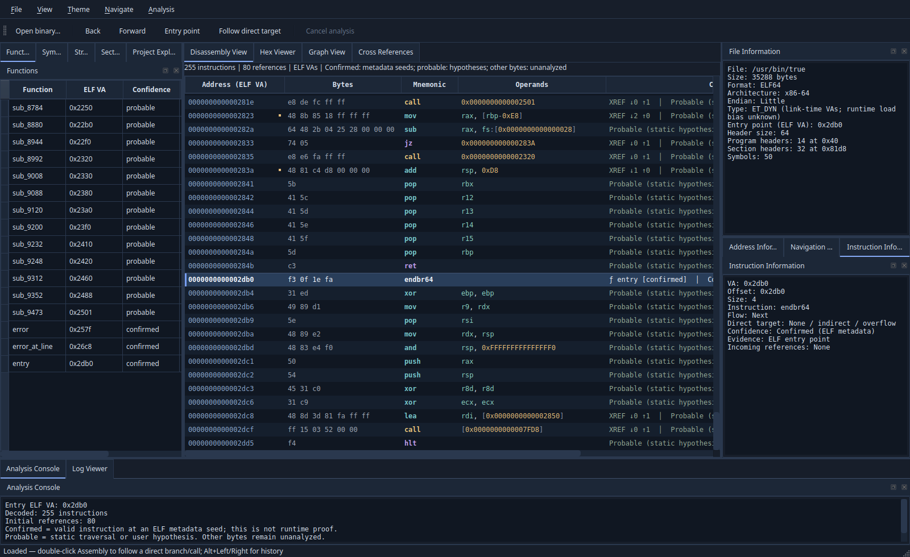
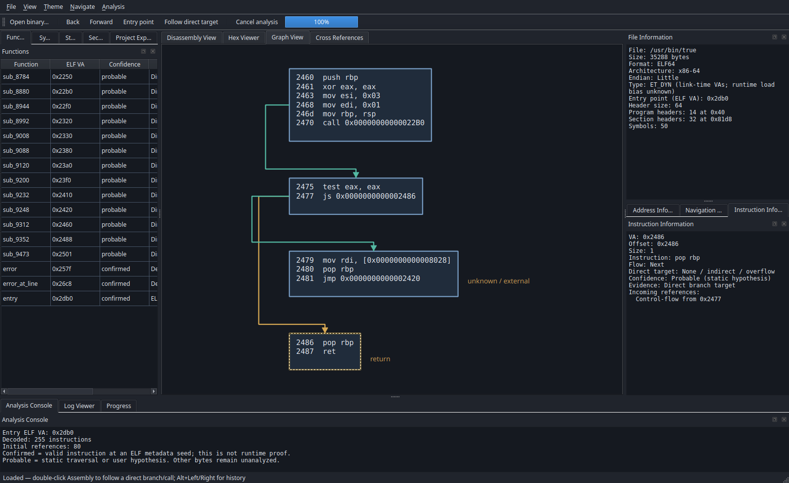

# REA Studio v0.3.0-alpha

Disassembler estático open source em **C++20 e Qt 6 Widgets**. Inspeciona ELF32/ELF64 e decodifica **x86-64 little endian ELF ET_EXEC/ET_DYN** com Zydis. Não executa os binários analisados. Não oferece decompilação ou pseudocódigo.

Repositório de destino: [eltpmoc/REA-Studio](https://github.com/eltpmoc/REA-Studio). Esta árvore prepara a primeira publicação do código; nenhum push ou release foi feito pela preparação local.





## Funcionalidades

- Parser ELF32/64 little/big endian: cabeçalhos, segmentos, seções, símbolos e hex com offsets de 64 bits.
- Assembly x86-64 real com bytes, endereços, mnemônicos, operandos, evidência/confiança e destaque de sintaxe.
- Funções por símbolos, entry e calls diretos; delimitação conservadora, retornos, entradas duplicadas e sobreposição. Confiança confirmed/probable/unknown explícita; saltos não viram funções automaticamente.
- Blocos básicos/CFG, fallthrough, branches, destinos desconhecidos, retornos, ciclos e limites globais de nós/arestas.
- Referências de entrada/saída por função, duplo clique, histórico voltar/avançar e indicadores XREF no Assembly. Indiretos não recebem destinos inventados.
- Graph View própria com seleção/destaque, zoom/pan, navegação e exportação PNG/SVG.
- Workspace com 12 docks, temas Dark/Light originais, QSettings, símbolos importados/indefinidos e progresso recolhido ao concluir.
- Análise em std::jthread, cancelamento cooperativo, limites de trabalho/prazo/memória contabilizada e cota de instruções compartilhada entre navegações.

O alvo é inspecionado, não carregado como biblioteca nem executado. Confirmed indica evidência de metadados, não observação de execução. ET_DYN usa VA de link, sem base de processo inventada.

## Sistemas e estado de validação

| Plataforma | Estado desta preparação |
|---|---|
| Linux x86_64 | Build Release GCC, Debug Clang e ASan/UBSan: 17 testes preservados; veja o relatório local |
| Windows x64 / MSVC | Preset, CI, CTest e deployment preparados; **sem execução Windows local, sem ZIP Windows validado** |
| Outros sistemas/arquiteturas | Sem validação ou pacote nesta alpha |

Qt gráfico é testado em **offscreen**. Isso não equivale a validação desktop nativa. O workflow Windows precisa executar de fato após o push autorizado para comprovar compatibilidade. O aplicativo Windows continua sendo um analisador ELF, sem PE.

## Requisitos e compilação Linux

CMake >=3.21, compiladores C/C++ com C++20/std::jthread, Qt >=6.2 Widgets e Qt Test para testes; Python >=3.10 para auditoria/pacotes. Zydis 4.1.1/Zycore 1.5.2 são vendorizados e não requerem rede no CMake.

```sh
sudo apt-get install build-essential cmake qt6-base-dev qt6-base-dev-tools python3
python3 scripts/release.py audit
cmake --preset linux-release
cmake --build --preset linux-release -j"$(nproc)"
ctest --preset linux-release --output-junit release-tests.xml
./build-release/rea-studio /usr/bin/true
```

Também funciona o fluxo CMake tradicional `cmake -S . -B build -DCMAKE_BUILD_TYPE=Debug`, build e CTest. Clang e sanitizers usam diretórios separados. Veja [build Linux](docs/build-linux.md).

## Compilação Windows x64

Visual Studio 2022 Desktop C++, Windows SDK, CMake, PowerShell 7, Python e Qt 6.8.3 MSVC2022 x64. Em Developer PowerShell:

```powershell
$env:CMAKE_PREFIX_PATH = 'C:/Qt/6.8.3/msvc2022_64'
$env:PATH = 'C:/Qt/6.8.3/msvc2022_64/bin;' + $env:PATH
python scripts/release.py audit
cmake --preset windows-x64
cmake --build --preset windows-x64 --parallel
ctest --preset windows-x64 --output-junit windows-release-tests.xml
```

Deployment com windeployqt, fontes/licenças Qt e smoke sem Qt no PATH de desenvolvimento: [build Windows](docs/build-windows.md). Não declarar Windows validado antes de seus relatórios reais. O CI preserva falhas obrigatórias e não publica releases.

## Testes e CI

Os **17 testes existentes** foram mantidos: parser/malformados/endian/arquivo de 5 GiB, Assembly e tradução, funções/CFG/loops/xrefs, limites/cancelamento/concorrência, worker/lifetime, navegação/modelos/temas/progresso, exportações e fuzz smoke. No Windows são 12 aplicáveis; cinco testes dependem de /usr/bin/true no Linux.

[GitHub Actions](.github/workflows/ci.yml): Linux GCC/Clang, Windows MSVC x64, ASan/UBSan, TSan do núcleo/controlador, integridade dos 107 arquivos e licenças, fuzzing curto, pacotes e relatórios retidos por 30 dias. Actions fixadas por SHA, permissões de leitura, sem publicação remota de release e sem continue-on-error.

**Pendência TSan:** núcleo/controlador possui escopo aprovado; widgets emitiram relatórios em QArrayData/pool do Qt instalado não instrumentado. Não há aprovação global da GUI, nem supressões para esconder falhas. Qt instrumentado e nova investigação são necessários. ASan/UBSan não instrumenta o Qt do sistema; LeakSanitizer segue desativado no ambiente local sob ptrace.

Resultados e comandos desta entrega: [preparação pública](docs/publication-readiness.md). Resultados históricos: [v0.3.0](docs/validation-v0.3.0.md) e [refinamento visual](docs/visual-refinement.md). Nenhum resultado remoto é alegado antes de sua execução.

## Pacotes e instalação

```sh
python3 scripts/release.py linux --build build-release --output dist
(cd dist && sha256sum -c SHA256SUMS.txt)
```

O pacote Linux usa **Qt e bibliotecas do sistema**; não é universal/AppImage. A distribuição local foi construída em Ubuntu 26.04.1, Qt 6.10.2 e GCC 15.2. Consulte build metadata/dependências antes de executar em outro SO. O CI Ubuntu 24.04 produzirá binário para seu próprio ambiente.

Artefatos locais esperados: Linux-x86_64.tar.gz, Source.tar.gz, SHA256SUMS.txt e RELEASE-NOTES.md. Windows-x64.zip só deve ser incluído depois de build/testes/deployment reais em Windows. [Instalação](docs/installation.md) e [processo de release com aprovação](docs/release-process.md).

## Uso do workspace

Ctrl+L navega por VA ELF; Ctrl+G por offset. Duplo clique/Enter segue destino direto no Assembly. Alt+Left/Right percorre o histórico; Ctrl+C copia seleção. Functions/Symbols/References/Graph View usam a mesma navegação validada. A roda faz zoom no grafo; arrastar fundo faz pan; File exporta PNG/SVG da função ativa. View reabre painéis, inclusive o último progresso; Theme alterna Dark/Light.

Limites padrão: 128 MiB de reservas conservadoras do núcleo, 10 s, 20.000 tentativas de decoding por projeto, 1.000.000 itens de trabalho, 4096 nós e 16384 arestas de CFG por pedido. A cota de instruções é compartilhada com navegações. Graph View tem limites visuais menores. Memória contabilizada não é cap de RSS; cancelamento não interrompe syscall bloqueada. Parser/decoder/funções/CFG ficam no worker; publicação de modelos ainda é síncrona na GUI.

## Licenciamento

Código original: **GPL-3.0-or-later**, com texto integral em [LICENSE](LICENSE) e contexto em [COPYING.md](COPYING.md). Zydis/Zycore: **MIT**, textos e copyrights originais preservados. Qt e dependências mantêm suas próprias licenças; veja [THIRD_PARTY_NOTICES.md](THIRD_PARTY_NOTICES.md). Pacotes binários incluem fonte correspondente REA; o pacote Windows proposto também inclui fonte QtBase e seus avisos. Sem código ou recursos proprietários de Hopper/IDA.

**Gate de publicação:** o commit inicial do remoto tem LICENSE MIT, enquanto o código local já usava GPL. A reconciliação precisa de aprovação do mantenedor e confirmação de direitos, preservando o commit remoto. Nenhum arquivo remoto foi substituído por esta preparação.

## Limitações e roadmap

Sem PE, ARM64 disassembly, decompilação, jump tables, resolução de indiretos/GOT/PLT, strings, DWARF, banco incremental ou MCP ativo. Análise conservadora pode ficar incompleta. Sem processo isolado, sandbox, cgroups/Job Objects ativos, snapshot de arquivo, assinatura ou auto-update. [Limitações completas](docs/known-limitations.md) e [segurança](docs/security.md).

Próximos passos: validar Windows e desktop nativo; investigar widgets com Qt instrumentado; publicar modelos em lotes; implementar worker em processo separado e IPC validado; ampliar análise/fuzzing antes de novos formatos/arquiteturas.

Documentação técnica: [arquitetura](docs/architecture.md), [funções](docs/function-analysis.md), [CFG](docs/control-flow-graph.md), [referências](docs/cross-references.md), [execução assíncrona](docs/async-analysis.md), [isolamento futuro](docs/isolation-design.md) e [changelog](CHANGELOG.md).
