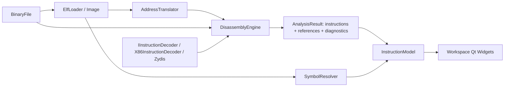
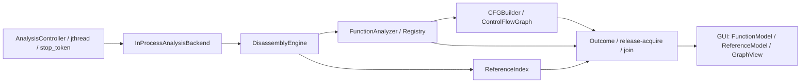

# Arquitetura e segurança — v0.3.0

## Camadas

- `rea_core`: C++20 padrão, sem Qt. I/O limitado, parser ELF, modelos, tradutor, resolvedor, decoder, motor, FunctionAnalyzer, CFGBuilder/Validator, ReferenceIndex e IAnalysisBackend.
- Zydis 4.1.1 + Zycore 1.5.2: dependências C estáticas locais com licença MIT original. Não requerem rede no build nem dependem do executável analisado.
- `rea_ui`: InstructionModel, FunctionModel, ReferenceModel, GraphView, AnalysisController e QMainWindow com workspace, navegação e QSettings.
- `rea-studio`: inicialização do QApplication e modo de smoke test.

`Loader` continua sendo o contrato para um futuro PE. `IInstructionDecoder::decode` recebe no máximo 15 bytes, VA ELF e offset. `X86InstructionDecoder` configura LONG_64, decodifica usando ZydisDecoderDecodeFull e formata operandos Intel. Cada `Instruction` armazena VA, offset, size, bytes, mnemonic, operands, FlowType, destino direto opcional, referências de dados, Confidence e evidência textual. Não há pseudocódigo.

O antigo AssemblyBackend e CfgBackend continuam como contratos de compatibilidade; BasicBlock preserva seus campos. O CFG concreto usa CFGBuilder/ControlFlowGraph. InspectionService continua apenas contrato futuro; sem transporte MCP ativo.

## Parser e limites de I/O

`BinaryFile` aceita apenas arquivos regulares antes de abrir o stream; diretórios, FIFOs e dispositivos são recusados. Usa streams binários e offsets de 64 bits. Antes da leitura, valida `offset <= size`, `count <= size-offset`, limite de 16 MiB por leitura e representabilidade em streamoff. Verifica leitura curta. Não lê o arquivo inteiro. Não há snapshot: alterações externas no arquivo podem produzir erros ou inconsistência entre a análise e bytes posteriores.

ELF não utiliza casts para estruturas nativas nem depende de alinhamento/endian do host. Valida EI_CLASS/EI_DATA, versão, tamanho do cabeçalho, tabelas de programas/seções, stride mínimo, contagem e referências de strings/símbolos. Tabelas são validadas por divisão antes de multiplicações. PT_LOAD valida fileSize/memorySize e overflow de intervalo virtual. SHT_NOBITS e seção nula não demandam conteúdo no arquivo. e_shnum/e_shstrndx/e_phnum estendidos usam seção zero. SHN_XINDEX de símbolos é recusado explicitamente. ELF sem seções continua permitido.

Limites do parser: 200.000 registros por tabela e 200.000 símbolos totais; nomes de até 4096 bytes terminados dentro da tabela. Esses limites podem rejeitar ELFs válidos muito complexos. Não interpreta relocações, DWARF, compressão, versões de símbolos ou dependências dinâmicas, nem implementa um verificador completo de ABI. Valores de tipos/arquiteturas desconhecidos são preservados.

## Espaços de endereços

`AddressTranslator` recebe Image, tamanho de arquivo e load bias opcional. Só ET_EXEC e ET_DYN têm mapeamento virtual nessa fase. Para cada PT_LOAD valida:

- `offset <= fileSize` e `p_filesz <= fileSize-offset`;
- `p_filesz <= p_memsz`;
- `p_vaddr <= UINT64_MAX-p_memsz`.

`toFile` recebe **VA ELF de link**. Só bytes em p_filesz são mapeados; BSS fica sem offset. Mapeamentos com offsets diferentes para uma VA são rejeitados; sobreposição idêntica exige permissão executável em todos os segmentos para decodificar. `toVA` recusa múltiplas VAs para o mesmo offset e verifica o round trip.

`toRuntime`/`fromRuntime` convertem numericamente VA ELF e runtime usando bias explícito, com checagem de overflow/underflow; conversão numérica não certifica que uma VA esteja mapeada. ET_EXEC não aceita bias diferente de zero. ET_DYN recebe bias zero por padrão (endereços de link), sem supor uma base de processo. A GUI não expõe conversão runtime nem ASLR; usa VA ELF e file offset. ET_REL conserva inspeção por offset sem mapeamento virtual inventado.

A API legada `Image::offsetForAddress` ganhou proteção própria contra overflow; navegação e análise novas usam AddressTranslator com tamanho de arquivo.

## Análise e confiança

`DisassemblyEngine` faz percurso recursivo por fila, com conjunto de endereços visitados e intervalos de instruções não sobrepostos. Sementes automáticas: entry point e STT_FUNC definidos com seção válida. Sementes só são decodificadas em PT_LOAD executável. Solicitação explícita de navegação adiciona uma hipótese, sem confirmar bytes arbitrários.

- Calls diretos: registrar referência, enfileirar destino e seguir fallthrough provável.
- Jumps condicionais: registrar/enfileirar destino e seguir fallthrough.
- Jumps incondicionais: seguir destino direto quando houver; não há fallthrough.
- Jumps indiretos, retornos e instruções de parada (incluindo HLT, UD2, interrupções e transições de sistema): encerrar percurso.
- Calls indiretos: destino permanece desconhecido; fallthrough é uma hipótese.
- Encoding inválido/truncado: reter um byte como registro `invalid`, sem inventar instrução válida; encerrar percurso.
- RIP-relative em operando de memória: registrar referência inicial de dados, sem promover seu destino a código.

Destinos relativos usam soma com checagens de overflow/underflow, sem depender de wrap de uint64. Antes de decodificar, cada byte potencial é validado contra os PT_LOAD, inclusive ambiguidades internas à instrução. Não cruza o fim do mapeamento atual para completar instruções. Destinos no interior de instrução já conhecida são rejeitados com diagnóstico; não há interpretações sobrepostas.

**Confirmed**: instrução válida em endereço de metadado ELF explícito. **Probable**: fluxo estático/destino direto/navegação solicitada. **Unanalyzed**: encoding inválido ou bytes não percorridos (estes não geram linhas falsas). Metadados podem mentir: Confirmed não significa execução observada ou resultado infalível. O engine não faz linear sweep de seções inteiras.

Orçamento padrão: cota global de 20.000 tentativas de decoding por projeto, 128 MiB de reservas conservadoras do núcleo e 10 s por pedido, configuráveis. Até 256 program headers para desmontagem. Ao exceder headers, o ELF continua inspecionável e a análise é recusada com diagnóstico. Análises interrompidas por orçamento são sinalizadas. Navegar para região executável ainda não analisada recalcula o resultado com prioridade para a VA solicitada; não é um banco de análise incremental. A seleção no interior de instrução existente é rejeitada em vez de redefinir limites.

`SymbolResolver` resolve nomes definidos por endereço exato, inclusive aliases limitados a 4096 bytes. Não resolve imports/GOT/PLT, símbolo mais próximo, deslocamentos internos, relocações ou DWARF.

## Qt e workspace

`InstructionModel` é QAbstractTableModel com cinco colunas, roles para VA/offset/fluxo/confiança/destino, tooltips, fonte monoespaçada e cores por categoria com paletas Dark/Light. Reset de análise usa beginResetModel/endResetModel. Invariantes são verificadas por QAbstractItemModelTester. Sections/Symbols permanecem em QTableWidget para preservar comportamento existente.

Doze docks periféricos em três áreas; centro com abas Disassembly View, Hex Viewer, Graph View e Cross References. Nomes estáveis de docks e versão de estado 2 permitem restoreState. QSettings persiste layout, geometria e tema no fechamento normal, sem salvar arquivo/projeto. Em Linux usa a localização padrão de configurações Qt; em Windows, backend nativo. Testes usam diretório temporário próprio ou desativam persistência.

Histórico de até 1000 posições guarda o tipo de endereço (VA ou offset), permite voltar/avançar/ativar posição e descarta o caminho futuro após nova navegação. Cada projeto novo reinicia o histórico. Follow de call/jump registra a origem antes do destino. Hex tem páginas de até 4 KiB e ASCII imprimível entre 32 e 126.

Parser, decoder, funções, referências e CFG rodam em worker dedicado std::jthread; Progress mostra fase, consumo da cota, memória contabilizada e tempo. Cancelamento é cooperativo. O controlador mantém mailbox com mutex e publicação com release/acquire + join; widgets só são acessados na GUI. A publicação de modelos ainda é síncrona na GUI. Veja [execução assíncrona](async-analysis.md). Erros de carregamento antes do commit preservam projeto anterior; erros de leitura/navegação são registrados sem lançar exceção pelo event loop. Strings e funções não descobertas não recebem conteúdo simulado. Functions usa FunctionModel com confiança e evidência, sem afirmar recuperação completa de funções.

Nenhum comando, processo alvo, biblioteca do binário ou shell é executado. Widgets de nomes/símbolos usam texto simples. Logs e relatórios ficam na sessão, sem rede ou MCP ativo.

## Evolução

Limites de RSS por processo ou allocator exato, cache de leituras, publicação em lotes, modelos virtualizados de símbolos/seções, expansão do fuzzing e isolamento do parser. Depois: resolução de indiretos, CFG mais completo e PE. Os contratos ainda não prometem compatibilidade binária entre versões.

## Programa e backend v0.3.0

`InProcessAnalysisBackend` implementa IAnalysisBackend e retorna Assembly + ProgramAnalysis. FunctionAnalyzer delimita membros a partir de sementes ELF/entry/calls diretos. CFGBuilder particiona membros, cria arestas e usa Kahn para ciclos; orçamento global limita nós/arestas. ReferenceIndex gera índices tipados de entrada/saída. Dados são construídos no worker e movidos para Window após join; FunctionModel e ReferenceModel são criados/resetados na GUI. GraphView limita a cena antes de alocar itens.

O backend atual compartilha o processo da GUI. `rea::protocol` define mensagens C++ versionadas e transições testadas para evolução futura; não existe transporte ou worker externo. LinuxCgroupV2Policy e WindowsJobObjectPolicy são interfaces abstratas sem enforcement. Ver [isolamento](isolation-design.md), [funções](function-analysis.md), [CFG](control-flow-graph.md) e [referências](cross-references.md).

Sinais de AnalysisController são emitidos por poll/start/cancel na thread proprietária da GUI, não pelo worker; conexões locais podem ser diretas. Não há emissor de worker conectado a widgets que exija QueuedConnection no fluxo atual. Futuro emissor de outra thread deve usar QueuedConnection e contexto QObject com lifetime controlado. Métodos públicos de Window/modelos/GraphView têm o contrato usual Qt de uso exclusivo na GUI; não são APIs thread-safe. O teste do controlador observa explicitamente a thread dos callbacks. O worker compartilha só cancel/contadores atômicos e mailbox protegida por mutex; AnalysisControl.work/reserveMemory pertencem a um único worker.

## Refinamento visual

AssemblyDelegate desenha operandos com QTextLayout e formatos por token, sem HTML e sem modificar instruções. FunctionEntryRole/FunctionNameRole identificam separadores nas linhas existentes; IncomingReferencesRole/OutgoingReferencesRole expõem contagens do resultado de disassembly. Nenhuma linha sintética altera índices, endereços ou histórico. O modelo mantém cinco colunas e os roles anteriores.

applyWorkspaceTheme centraliza a paleta Dark/Light e estilos dos controles Qt. O painel Progress e sua ação de widget na toolbar aparecem enquanto o controlador está ocupado e são ocultados no busyChanged(false); o conteúdo final é preservado e o dock pode ser reaberto por View. A classificação de símbolos é apresentação dos metadados ELF, sem resolver imports/GOT ou endereços de runtime. Veja [refinamento visual e evidências](visual-refinement.md).

## Memória de processos em execução

ProcessMemory é um backend de leitura distinto de BinaryFile/ELF. ProcessDescriptor contém PID, identidade de criação e metadados; MemoryRegion usa VAs de runtime e fim exclusivo; MemoryPage contém somente bytes efetivamente lidos e erro/partial explícito. Não há tradução de runtime para ELF implícita nem análise estática automática dos bytes vivos.

ProcessView agrega ProcessModel/MemoryRegionModel e um worker std::jthread ativo com no máximo um pedido pendente. Cada pedido tem ID; substituição solicita stop e só o mais recente é publicado. ProcessJobState é publicado por release/acquire e consumido após join. Workers usam dados/handles privados, nunca widgets. Tabelas, texto, status e cópia são manipulados na GUI. Atualização automática lê uma página por segundo apenas enquanto a aba está visível e o worker ocioso; fechar cancela e faz join. Veja process-memory.md para interfaces, identidade, OS, limites e testes.

## Escrita e IR experimental

ProcessMemory conserva o modo de acesso por sessão; write(expected,replacement) exige região r/w, comparação prévia e retorno MemoryWriteResult com contagem real e read-back. A GUI serializa a escrita e não descarta seu efeito em cancelamento/supersessão/fechamento. Undo é apenas a inversão condicional do último patch verificado. Ver process-memory.md.

X86IRLifter gera IRInstruction/IRFunction no worker, a partir dos bytes dos membros de função. ProgramAnalysis contém o mapa IR por entry. Modelagem de operandos é tipada, lowering GPR é parcial e unknown fica opaco. As abas de texto possuem limite explícito de 2048 instruções por função, sem truncar silenciosamente cabeçalhos. Não há SSA, AST, tipos ou semântica executável completa. Ver decompilation-ir.md e reverse-engineering-roadmap.md.

## Navegação por funções e análise sob demanda

FunctionSearchModel combina FunctionModel e SymbolModel por VA, preservando aliases no índice de pesquisa. GoToFunctionDialog usa QSortFilterProxyModel na GUI; demangling ocorre no parser no worker. SymbolModel também fornece os dados à tabela de símbolos existente.

InstructionModel publica um shared_ptr<const AnalysisResult>. AnalysisController passa essa referência imutável ao backend incremental, que valida bytes/mapeamentos existentes e decodifica somente novos endereços. Funções, CFG, referências e IR são reconstruídos sobre a união. A GUI aceita o resultado apenas quando o alvo e seus modelos derivados estão disponíveis; cancelamento/falha conserva a publicação anterior. Cota de instruções é compartilhada durante a sessão, sem cobrar novamente instruções reutilizadas. Não há banco persistente nem snapshot atômico do arquivo. Ver [contrato, testes e limitações](function-navigation.md).

## Semantic IR v0.3.1

SemanticResult adiciona SSA local de bitvectors e def-use sobre IRFunction, com estado abstrato de aliases GPR e células little endian de pilha. A recuperação C-like aceita apenas projeções de retorno inteiro sem fluxo desconhecido, mantendo MachineState e motivo de recusa. Ver [semântica e fronteiras](semantic-ir.md) e [validação real](decompiler-v0.3.1.md).

## Análise de fluxo em desenvolvimento

ControlFlowFacts consome CFG validado no worker e registra dominadores, pós-dominadores de grafos fechados acíclicos e corpos de laços naturais. Os fatos enriquecem a IR detalhada; ainda não autorizam transformação automática do C-like. Ver decompiler-v0.3.2.md.
