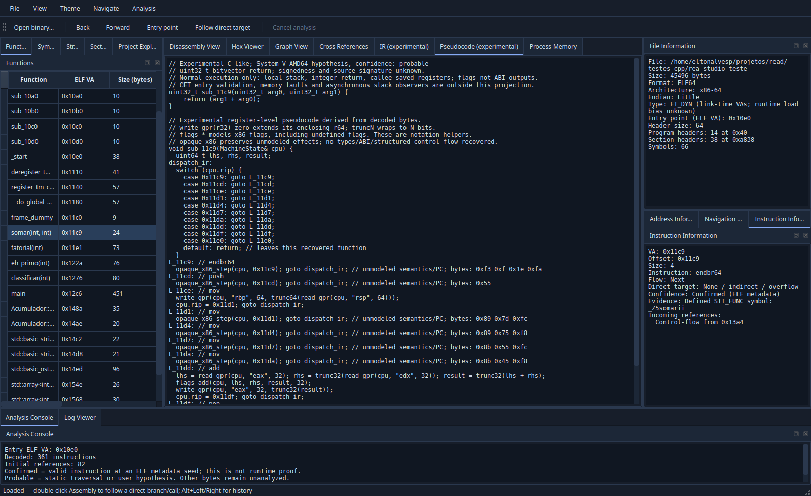

# Decompiler v0.3.1 — primeira recuperação semântica

O modo Pseudocode apresenta C-like quando comprovável e mantém abaixo o MachineState detalhado. A aba IR também conserva a listagem e MachineState. Recusas exibem o motivo e as operações opacas originais. Não é decompilação C++ completa.

## Caso obrigatório real

O teste required_function_navigation abre o ELF rea_studio_teste existente, encontra o símbolo original pela tabela ELF, navega pela GUI e valida a saída C-like real. Endereço e nome específicos aparecem somente no teste. SHA do arquivo e flags -O0 -g estão em function-navigation.md.

Saída efetiva recuperada no VA de link do arquivo:

```c
// System V AMD64 hypothesis; confidence: probable
// signedness and source signature unknown
uint32_t sub_11c9(uint32_t arg0, uint32_t arg1) {
    return (arg1 + arg0);
}
```

A função identificada no catálogo é somar(int, int). A expressão equivale à adição de32 bits da máquina, inclusive wraparound; para entradas sem overflow assinado coincide com o int da fonte. O nome gerado sub_<VA> é genérico. Não afirmamos ter recuperado o tipo de retorno int32_t: isso exige evidência de tipos adicional. O motor não contém correspondência pelo símbolo, endereço ou bytes desse teste.



## Testes e reprodução

```sh
cmake -S . -B build -DCMAKE_BUILD_TYPE=Debug \
  -DREA_NAVIGATION_TEST_ELF=/home/eltonalvesp/projetos/read/testes-cpp/rea_studio_teste
cmake --build build -j"$(nproc)"
ctest --test-dir build --output-on-failure
ctest --test-dir build -R '^required_function_navigation$' -V
```

semantic_ir verifica stack frame, spill/reload, bytes little endian, AH/AL, preservação parcial, escrita32, constantes, wraparound, sexto argumento, restauração de pilha e recusas para memória externa, branches, syscall e MOVZX. O teste real compara a expressão avaliada com adição modular em valores controlados, incluindo limites. Isso é evidência de casos controlados, não prova formal contra execução nativa de todos os estados. Os testes anteriores foram preservados.

Logs: build/semantic-tests.log, build-clang/semantic-tests.log, build-asan/semantic-tests.log, build-tsan/semantic-tests.log e build/semantic-required-evidence.log. Qt usa offscreen; Windows e desktop nativo não validados. ASan usa detect_leaks=0 pela limitação LSan/ptrace já documentada. TSan é limitado aos testes do núcleo; pendências Qt anteriores permanecem sem supressões globais.

## Pendências explícitas

Esta entrega cobre recuperação local de aritmética inteira e stack frames simples. Não conclui SSA global, semântica geral de memória/LEA/PUSH/POP, execução de flags ou inferência assinada da assinatura solicitados para a arquitetura completa. Não inventa classes, estruturas de controle ou variáveis-fonte. Consulte semantic-ir.md para os critérios de aceitação e recusa.

A primeira execução ASan/UBSan teve 24/25: a fixture C++ compilada com UBSan contém JNO e chamada __ubsan_handle_add_overflow. O teste incorretamente exigia recuperação reta também dessa função instrumentada. O teste passou a exigir recusa explícita quando a fixture contém branch/call; nenhum sanitizer foi desativado. O ELF obrigatório continua exigindo recuperação bem-sucedida em todas as configurações. O log inicial semantic-tests.log foi preservado; a repetição está em build-asan/semantic-tests-final.log.

Resultados finais locais: GCC Debug **25/25**, Clang Debug **25/25**, ASan/UBSan **25/25**, TSan núcleo **8/8**. Todos os24 testes anteriores permaneceram. Builds finais GCC/Clang/ASan sem warnings registrados; git diff --check passou, índice original preservado e 107 dependências íntegras. Nenhuma publicação efetuada.
