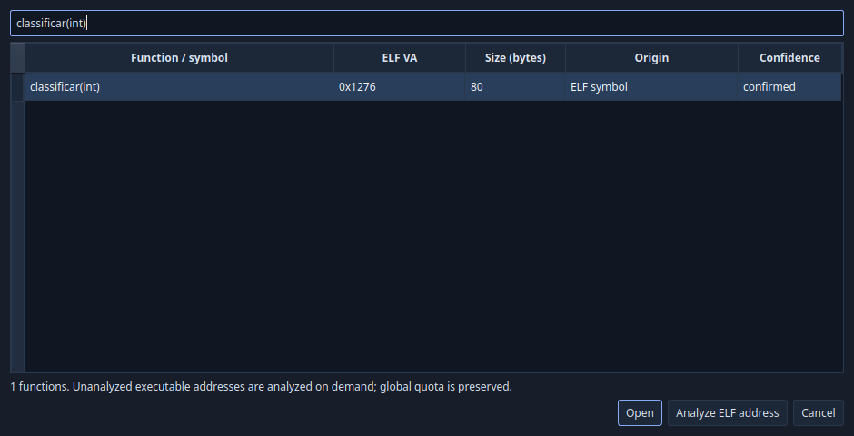
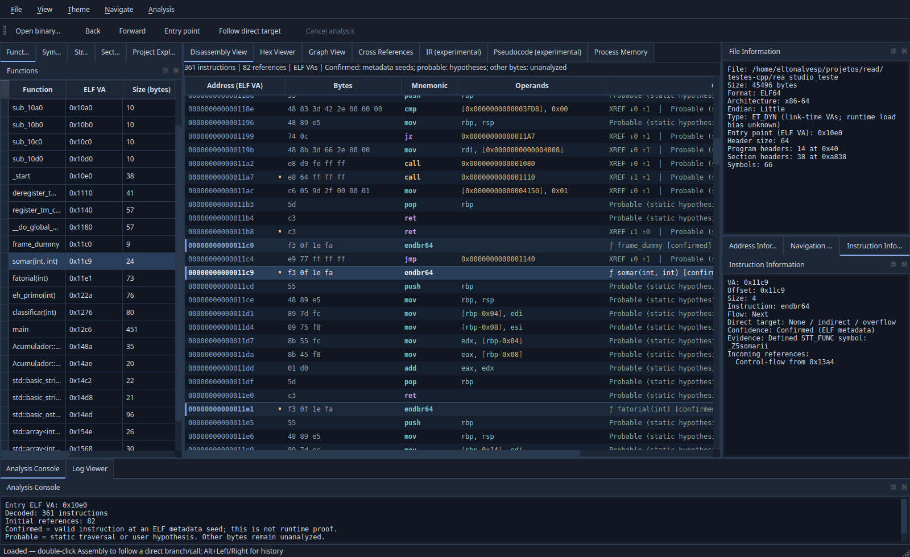

# Navegação por funções e análise ELF sob demanda

Implementação e validação local em 2026-11-04, Linux x86_64, Qt 6.10.2, GCC 15.2 e Clang 21.1.8.

## Uso

Abra um ELF e escolha **Navigate → Go to Function…**, ou **Ctrl+Shift+F**. O filtro incremental pesquisa nomes, nomes C++ demangled, símbolos originais, VAs hexadecimais (com/sem `0x`) e funções heurísticas `sub_<VA>`. Palavras são combinadas por AND sem distinção de maiúsculas. A tabela apresenta nome, VA ELF, tamanho em bytes, origem e confiança. Aliases no mesmo VA são reunidos e continuam pesquisáveis. Símbolos indefinidos não são destinos navegáveis.

Enter/Open ou duplo clique navega ao resultado. Para um endereço ainda ausente, digite o VA e use **Analyze ELF address**. Esse botão também desambigua nomes que parecem números hexadecimais. Os endereços são VAs de link ELF, sem base ASLR de processo. A seleção sincroniza Functions, Assembly, Graph View, Cross References, IR e Pseudocode experimentais, com histórico voltar/avançar.





## Contrato de análise

O pedido exige ELF x86-64 little endian e endereço mapeado em região executável. Endereços no meio de instruções conhecidas são recusados. A análise roda em std::jthread com stop_token; a interface mantém os dados anteriores durante o trabalho. O worker recebe uma referência imutável às instruções existentes, confere seus bytes e mapeamentos no arquivo reaberto e percorre o novo destino. Apenas novas tentativas de decodificação consomem a cota global compartilhada. Cancelar não restitui trabalho já consumido.

A união das instruções alimenta novamente funções, CFG, referências e IR sob os limites existentes de trabalho, prazo, memória contabilizada, nós e arestas. Não se presume que todo salto inicia uma função. Uma nova entrada solicitada manualmente recebe origem User requested e confiança probable quando há código válido; símbolos ELF mantêm sua evidência própria. A GUI só publica a navegação se houver instrução válida, função, CFG e IR disponível para o resultado. Cancelamento, falha ou limite impeditivo preservam o conjunto anterior, inclusive pseudocódigo e referências.

Tamanho declarado em ELF é usado quando disponível; nos demais casos é a extensão observada, não prova de fronteira exata. Tooltips preservam símbolo original e informação de sobreposição. FunctionModel e SymbolModel expõem roles de navegação; FunctionSearchModel integra ambos sem duplicar entradas por endereço.

## C++ e limites

Demangling Itanium usa `abi::__cxa_demangle` quando disponível; símbolos MSVC podem usar DbgHelp no Windows, com acesso serializado. Nomes originais são preservados e permanecem pesquisáveis. Entradas grandes/complexas são recusadas conservadoramente (512 bytes, guardas de complexidade); resultado acima do limite de 16 KiB cai para o original. A chamada de biblioteca não possui cancelamento interno nem isolamento de memória. Referências de API: [GCC demangling](https://gcc.gnu.org/onlinedocs/libstdc++/manual/ext_demangling.html), [Qt proxy model](https://doc.qt.io/qt-6/qsortfilterproxymodel.html).

Reuso incremental vale para a sessão; não há banco persistente. Conferir bytes anteriores não torna o arquivo um snapshot atômico: alterações concorrentes ainda são possíveis. Limites contabilizados não são limites de RSS. IR/pseudocódigo continuam experimentais, sem SSA/decompilação completa. Windows e desktop nativo não foram executados nesta validação. Pacotes antigos em dist e candidato publication-review não representam automaticamente estas alterações.

## Evidência obrigatória

Arquivo aberto, sem executá-lo: `/home/eltonalvesp/projetos/read/testes-cpp/rea_studio_teste`. DWARF registra GNU C++20 15.2, `-O0 -g -fno-inline -fno-omit-frame-pointer`. SHA-256: `ea3170f968d63766ee0355906625e655f8572b1afbe656523dc654157010a2e2`.

| Função encontrada e navegada | VA ELF | Tamanho |
|---|---|---|
| somar(int, int) | 0x11c9 | 24 |
| fatorial(int) | 0x11e1 | 73 |
| eh_primo(int) | 0x122a | 76 |
| classificar(int) | 0x1276 | 80 |

O teste usa a Window real, shortcut, pesquisa incremental, Enter e duplo clique. Verifica instrução selecionada, função, CFG com cena preenchida, referências, IR e pseudocódigo contendo o VA. As quatro têm origem ELF symbol e confiança confirmed. Endereços esperados existem somente no teste específico, nunca em src/include. Capturas são reais, produzidas por Qt **offscreen**; não comprovam interação desktop nativa.

## Comandos e resultados

```sh
cmake -S . -B build -DCMAKE_BUILD_TYPE=Debug \
  -DREA_NAVIGATION_TEST_ELF=/home/eltonalvesp/projetos/read/testes-cpp/rea_studio_teste
cmake --build build -j"$(nproc)"
ctest --test-dir build --output-on-failure
ctest --test-dir build -R '^required_function_navigation$' -V
```

`REA_NAVIGATION_TEST_ELF` é opcional, não incorpora caminhos locais no aplicativo. Sem ele, Linux executa 23 testes, incluindo uma fixture C++ própria compilada com -O0 -g cujos endereços são descobertos dinamicamente. Com o ELF obrigatório, são 24. Os 21 testes anteriores permanecem.

| Configuração executada | Resultado | Log local |
|---|---|---|
| GCC Debug | 24/24 | build/test-function-navigation.log |
| GCC Release | 24/24 | build/test-function-navigation-release.log |
| Clang Debug | 24/24 | build-clang/test-function-navigation.log |
| GCC ASan/UBSan | 24/24 | build-asan/test-function-navigation.log |
| Clang TSan, núcleo selecionado | 7/7 | build-tsan/core-function-navigation.log |
| ELF obrigatório, evidência detalhada | passou | build/required-navigation-evidence.log |

Clang usa `-DCMAKE_CXX_COMPILER=clang++-21`; ASan/UBSan usa `-DCMAKE_CXX_FLAGS='-fsanitize=address,undefined -fno-omit-frame-pointer' -DCMAKE_EXE_LINKER_FLAGS=-fsanitize=address,undefined`, com `ASAN_OPTIONS=detect_leaks=0` no CTest devido à limitação já registrada de LSan/ptrace. Isto não valida leaks. TSan usa flags equivalentes com `thread` e `TSAN_OPTIONS=halt_on_error=1`; seleção: `generate_fixture|analysis_control|analysis_worker_controller|program_analysis|process_memory|intermediate_representation|incremental_function_analysis`. TSan Widgets permanece pendente devido aos relatórios anteriores envolvendo Qt não instrumentado; nenhuma supressão global foi adicionada. Ver validation-v0.3.0.md.

Novos testes cobrem aliases/modelos Qt, demangling, destino desconhecido, reuso sem nova cobrança, bytes alterados, regiões não executáveis, cancelamento durante análise, limites, preservação de todas as views e histórico. A CI inclui os novos testes aplicáveis; Windows tem 18 preparados, sem alegação de execução real.

Auditoria final: git diff --check sem erros, índice original preservado por SHA-256, auditoria de licenças/inventário e integridade das 107 dependências aprovada. Nenhum push ou release efetuado.
