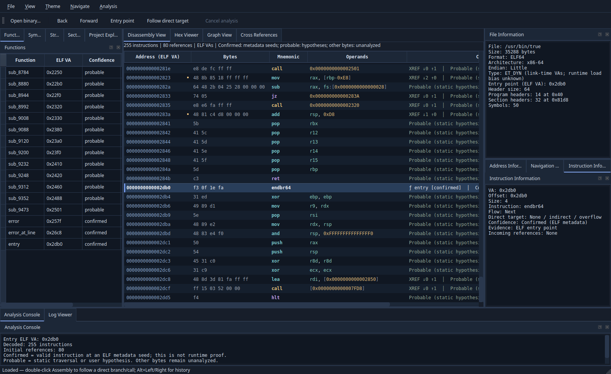
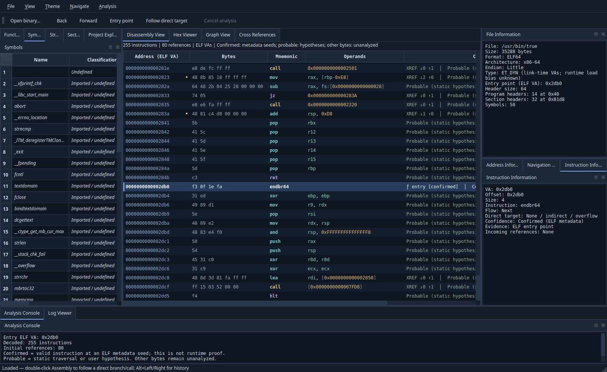

# Refinamento visual — v0.3.0

O workspace mantém os 12 docks, abas, nomes de objetos e persistência de layout da estrutura anterior. As funcionalidades de análise, Graph View, referências, navegação e cancelamento permanecem disponíveis.

## Apresentação

- AssemblyDelegate colore registradores em verde-água, constantes em âmbar e delimitadores/qualificadores de memória em tons neutros. Mnemônicos mantêm cores por fluxo; inválidos permanecem destacados como erro. O destaque é lexical, sem inferir semântica nova.
- Entradas de funções recebem linha separadora, fundo e marcador lateral, com nome/confiança nos comentários. Não são criadas linhas artificiais: índices e cinco colunas de instruções permanecem compatíveis.
- XREF ↓entrada ↑saída nos comentários, ponto âmbar em destinos referenciados e contagens nos tooltips. As referências continuam navegáveis na aba existente. As contagens do Assembly usam o vetor legado de referências, incluindo operandos RIP-relative; não são prova de execução.
- Symbols acrescenta Classification, posicionada visualmente depois de Name, sem alterar os índices das colunas anteriores. STT/BIND/seção originais continuam disponíveis. Símbolo dinâmico global/weak nomeado com SHN_UNDEF aparece como Imported / undefined; indefinido de outra origem como Undefined; demais como Defined, Absolute ou Common. Importação é candidata pelos metadados, sem atribuir biblioteca ou destino. Indefinidos não recebem endereço utilizável: exibem — e a navegação continua recusada.
- Progress e barra da toolbar são ocultados quando o controlador fica ocioso, inclusive após cancelamento/erro. O conteúdo permanece disponível por View → Progress. Novo pedido os exibe, sem remover docks ou alterar a contagem de testes de workspace.
- Tema Dark original de base azul-tinta, superfícies de ardósia e acentos azul/âmbar/verde-água. Paleta e stylesheet cobrem menus, toolbar, abas/docks, tabelas/árvores/listas, editores, entradas, diálogos, seleção, tooltips, scrollbars e estados desabilitados. Tema Light e QSettings são preservados.

## Arquivos

Novos: include/rea/assembly_delegate.hpp, src/assembly_delegate.cpp, include/rea/theme.hpp, src/theme.cpp e tests/visual_tests.cpp.

Alterados nesta etapa: include/rea/instruction_model.hpp, src/instruction_model.cpp, include/rea/window.hpp, src/window.cpp, CMakeLists.txt, README.md, CHANGELOG.md, docs/architecture.md e docs/validation-v0.3.0.md. Novas capturas: workspace-dark-v0.3.0.png e workspace-symbols-v0.3.0.png. Este documento registra a etapa separadamente da entrega inicial.

## Validação

GCC Debug **17/17**, Clang Debug **17/17**, ASan/UBSan **17/17**, preservando os 16 testes anteriores sem editar seus arquivos. Novo workspace_visual verifica cores de tokens, separadores sem mudança de índices, contagens XREF, classificação de símbolos em fixtures ELF, alternância Dark/Light e progresso em sucesso/cancelamento/erro/reabertura/novo pedido. Os testes anteriores continuam verificando navegação, Graph View, exportações, concorrência, cancelamento e /usr/bin/true.

```sh
cmake -S . -B build -DCMAKE_BUILD_TYPE=Debug
cmake --build build -j"$(nproc)"
ctest --test-dir build --output-on-failure
cmake -S . -B build-clang -DCMAKE_BUILD_TYPE=Debug
cmake --build build-clang -j"$(nproc)"
ctest --test-dir build-clang --output-on-failure
cmake -S . -B build-asan -DCMAKE_BUILD_TYPE=Debug
cmake --build build-asan -j"$(nproc)"
ASAN_OPTIONS=detect_leaks=0 ctest --test-dir build-asan --output-on-failure
```

Caches Clang e ASan mantêm as configurações documentadas na validação inicial (Clang 21 e -fsanitize=address,undefined). Logs em build{,-clang,-asan}/{configure,build,test}-visual.log. Nenhuma verificação foi desativada para aprovar esta etapa. LeakSanitizer continua com a limitação anterior detect_leaks=0. Houve inicialmente erro transitório em arquivos gerados do target CMake rea_ui_autogen; a build foi repetida e concluída antes dos resultados contabilizados. Nenhum resultado de executável antigo foi usado como validação do refinamento.

Testes gráficos e capturas usam Qt offscreen; não há validação nova de desktop nativo/Windows. TSan não foi repetido para alterações apenas de UI/modelos; os resultados e falhas anteriores não são reclassificados. Capturas de /usr/bin/true geradas por build/capture-visual.cpp com Window(false), sem executar o alvo, e inspecionadas visualmente.




